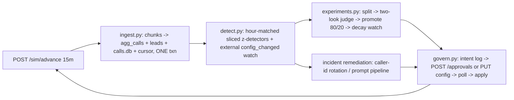

# Outcome-First Agent Loop — Submission

**Name:** Anjaneya Tiwari · **Date:** 2026-11-07 · **Hours actually spent (be honest):** `<FILL IN HONESTLY>` · **Language / storage:** Python 3.11+ / SQLite (WAL), two files: `state.db` (loop state) + `calls.db` (per-call audit)

---

## 0. TL;DR

A single-process, 15-minute-tick controller: ingest → detect → decide → act, all state keyed by workflow_id, every outbound change through an intent log with deterministic ids. public_01: **+4.9% conclusion rate, 0 harmful changes**. public_02: **+9.9% conclusion, hallucinated calls 416→191, caller-ID rotated out in ~1.5h, bad-prompt MTTR 225 min, 1 harmful change (−1.8pp, below our 3pp floor)**. public_03 (12 workflows at load): **+8.6% conclusion, 27 changes, 0 harmful**. Deliberately not built: per-person call-time optimisation (C4), a UI (C11 is a CLI), cross-tenant fairness (C15), full pre-D0 bootstrap (C3 beyond baselines/priors).

## 1. Assumptions

1. Client preferences that the policy API does not encode (Kestrel: ≤2 requests/day, none before 11:00) are honoured voluntarily as our own caution settings, always at least as strict as the API's governance block, and audited when they delay a proposal (D011).
2. History chunks are representative enough to seed hourly baseline *shapes*; levels are recalibrated on live data daily because a ~2–3pp history-vs-live offset was measured on both public scenarios (D016).
3. Calls (dials / connected calls) are treated as the unit of analysis, not persons; the sim re-samples the variant per dial so arms aren't person-clustered. The residual within-person correlation inflates variance; we buffer with minimum-n floors and Bonferroni and state it rather than model it (D013).
4. A rejected proposal with reason "judgement call" is random noise (base_reject_rate is 5–15% in every policy), so one retry with fresh data and a new attempt id is justified (D010).
5. `./run.sh` may be pointed at a fresh world at any time; the controller wipes its state only on hard evidence of a new world (scenario name change, or sim_minute/event-id/chunk-count going backwards), never on a normal restart.
6. Thresholds we own (z=3, 3pp effect floor, n≥300…) live in `controller/tuning.py` with one-line reasons; everything about a workflow comes from `GET /workflows` at runtime. Nothing scenario-specific is in code (D018).

## 2. Scope decisions

| # | Capability | Built / Partial / Cut | Why | What it would take to finish |
|---|---|---|---|---|
| C1 | Ingestion | **Built** | foundation; 15.1k events/s bench, 11.3k e2e under full loop | — |
| C2 | Shared cohort object | **Built** | `agg_calls` keyed (wid, hour, config_version, cohort_id, variant); detection, experiments, proposals and summary all read it | — |
| C3 | History bootstrap | **Partial** | hourly baselines + feature priors from history; no variant bootstrap because history has zero variant diversity (verified, step 5) | nothing useful left to build |
| C4 | Call-time / per-person | **Cut** | competes for the same test budget; hour effects are real (step 5) but schedule stays an incident lever only | per-cohort hour_weights from history priors, ~1 day |
| C5 | Caller-ID health | **Built** | sliced detector + staged rotation with safety rails (D016) | — |
| C6 | Variant experiments | **Built** | one dim at a time, all options in one proposal, 70/30, two looks, Bonferroni (D015) | factorial on big workflows |
| C7 | Promotion/decay/rollback | **Built** | 80/20 promotion; 20% residual feeds a 48h decay+guardrail watch; rollback via governance (26h delay in synthetic test) | — |
| C8 | Hallucination response | **Built** | detect → previous-good-prompt first → validate n=200 → propose with evidence → verify after; MTTR 225 min on public_02 | — |
| C9 | Governance client | **Built** | full state machine incl. stale/lapse/retry, approver-hours timing, deterministic ids with attempts | — |
| C10 | Honest impact numbers | **Minimal** | affected_leads from real lead rows; impact = measured Δ × moved volume ÷ daily KPI events; dry run = counterfactual on last-7d aggregates | richer counterfactuals |
| C11 | Supervisor view | **Minimal (CLI)** | `controller.summary`: changes/experiments/queue/incidents per workflow per day | a web page over the same queries |
| C12 | Audit store | **Built** | `audit` + `calls.db`; `why` and `heard` CLIs | — |
| C13 | Crash recovery | **Built & demonstrated** | kill -9 at 5 moments, 11/11 invariants (reports/crash_recovery.md) | — |
| C14 | Loop observability | **Minimal** | `controller.health` + per-day loop_health audit rows; page-on vs dashboard list | metrics export |
| C15 | Cross-tenant fairness | **Cut** | per-workflow request caps already policed by the sim; speculative at 3–12 workflows | a credit/attention scheduler per tenant |

Principle: build everything on the critical path of "safe lift + explainability" (detect → decide → govern → audit), cut everything that competes with it for the same test budget or adds surface without changing outcomes. Five things done properly beat fifteen sketches (README §6).

## 3. Stakeholders

### 01 Sales (Nikhil Rao)
- **Accepted:** speed where it is free — auto-apply used wherever policy allows (caller-ID rotation went live ~90 min after onset on public_02); one approval starts a whole multi-arm test.
- **Pushed back:** no single blended score (platform constraint §5.3 and Product's definition — pickup and engagement never blend); no "live by evening" (a 10pp winner needs ~380–460 samples/arm: 1–2 days at 30% challenger traffic; "winning by lunch" is peeking — measured 9–14% false winners); no hesitancy theatre, but every customer-audible change gets a named approval (Compliance condition 1).
- **Wrong claims (vs `GET /workflows`):** "Kestrel has auto-apply for everything" — false: ks_cancel allows auto only for schedule/caller_id/welcome/voice at max_shift 0.2 TV, never prompt_version. "Northwind fine with auto-apply on KYC" — false: nw_kyc has `auto_apply.enabled: false`, zero dims. The "persuasive" prompt (P4-style) cannot roll out on recollection: prompt changes require validation evidence ≥ the policy gate and approval, everywhere.
- **Reply:** *"Nikhil — the summit number exists: on the public incident scenario the loop lifted conclusions +9.9% overall and cut flagged hallucination calls by more than half, with every change approved or policy-permitted. Two corrections from the signed policies: Kestrel's auto-apply excludes prompts and caps shifts at 0.2, and Northwind KYC has auto-apply off entirely — a QBR remark doesn't change the contract. I can't give one blended score; pickup and engagement are separate KPIs by platform rule, so the slide gets both numbers. A winner that's ahead at lunch is usually noise at lunch: we measured 9–14% false winners deciding that way. Give a test one to two days and what we ship stays shipped."*

### 02 Northwind Compliance (Meera Iyer)
- **Accepted:** all four conditions are mechanical in the system — audible dims always via named approval (D009, even where policy would allow auto); validation evidence attached to every prompt proposal (`evidence.validation_run_id`, pass_rate ≥ policy gate); the IRDAI question is one command: `python -m controller.why heard --person <id> --day <date>` answers variant + config version + who approved it, from our own store, in seconds not 24h; weekly summary = `controller.summary`.
- **Pushed back:** nothing material.
- **Wrong claim:** "operational settings such as call timing and caller-ID rotation are covered by the policy we signed" — true for nw_renewal (auto: schedule, caller_id, max_shift 0.5) but **not for nw_kyc**, where auto-apply is off: even a caller-ID rotation on KYC goes to your approver. Our router reads this per workflow.
- **Reply:** *"Meera — agreed on all four conditions, and they're enforced in code, not in process docs. Anything a customer hears goes to your approver with a one-line summary, diff, affected-lead count, dry run and (for scripts) a validation run id. For an auditor's 'why did this customer hear that': one command against our own audit store returns the call, the variant, the config version and the approval that created it. One correction: on your KYC workflow the signed policy has auto-apply disabled entirely, so even caller-ID changes will arrive as requests — slightly slower, exactly as signed. Requests are timed inside 10:00–19:00/18:00 so your queue stays empty overnight."*

### 03 Platform/SRE (Kabir Menon)
- **Accepted:** kill test is a script, not a promise — `scripts/crash_test.sh` kills -9 at five moments incl. between intent-write and send, and after approval before apply; 11/11 invariants pass (no double apply, no lost approval, cursor exact). Idempotency: deterministic proposal ids (hash of wid|base_version|diff|kind|attempt) + cursor-with-data transactions + `INSERT OR IGNORE` on event_id. Alerts: `controller.health` separates page-on (ingest lag >100k, credits under reserve, open halluc incident, stuck intents) from dashboard-only. No new infra: SQLite is a file inside the service; the written production path is the Postgres you already run.
- **Measured for you:** one simulated load day in **~1.3 min** on 4 vCPU/8GB (python:3.11 container) — 7× inside your 10-min bound; 801 MB peak; 11.3k events/s end-to-end. At 10× the single-threaded tick loop saturates first; shard by workflow_id (every table already keyed by it), one feeder routing chunk events to N shard processes.
- **Wrong claims:** none.
- **Reply:** *"Kabir — crash test is `scripts/crash_test.sh`: one world, five kill -9 points including mid-governance, restart each time, invariant checker at the end (11/11). Idempotency is structural: deterministic proposal ids, cursor committed in the same transaction as the data it summarises. Load: a full simulated public_03 day runs in ~1.3 minutes on a 4-vCPU/8GB Linux container, 801 MB peak, controller fully active (32 governance actions). First thing to break at 10× is the single-threaded loop, not memory; the shard plan is in reports/load_public_03.md. No new stateful infra: SQLite files in-service now, your existing Postgres as the written production path. `python -m controller.health` gives lag, burn and incidents without logs."*

### 04 Kestrel Ops Supervisor (Anita Desai)
- **Accepted:** your edits are never undone — a supervisor `config_changed` marks our pending proposals stale and invalidates running experiments; we rebuild on your version (D-rule in design §7; exercised on public_02 where your voice edit was detected and nothing counter-acted). ≤2 requests/day and never before 11:00 are configured as our own caution layer (the signed policy actually allows 4/day from 10:00 — we chose your numbers, D011). One request carries a whole multi-arm test. `controller.summary` is your one screen. And the "verbatim script" worry is why winners are judged on engagement with a guardrail — a prompt that kills engagement without hallucinating is caught by the experiment stats and the 24h engagement detector, not just the halluc flag.
- **Pushed back:** "tell me before anything changes" on auto-applied rotations — policy permits them without pre-notice; they appear in the summary with reasons the same day. True pre-notice for those would re-serialize incident response.
- **Wrong claims:** none against policy (your asks are stricter than policy; we adopted them).
- **Reply:** *"Anita — your mid-day edits stay yours: the moment one lands, our pending requests for that workflow withdraw and running tests restart on your version; nothing reverts your change unless the data shows it hurting a KPI, and then it comes back to you as a request with the evidence. You'll get at most two requests a day, never before 11:00, bundled. One screen: `controller.summary` shows what's testing, what's winning, what's waiting on you, what changed today, with reasons. Caller-ID rotations inside your signed auto-apply latitude apply immediately during incidents and show up on the same screen the same day."*

### 05 Product (Tara Kulkarni)
- **Accepted:** pickup/engagement never blended (the objective and guardrail are read per workflow at runtime); one cohort object (`agg_calls` + config cohort ids is the single source for detection, experiments and the summary); proposals carry honest numbers (affected_leads counted from real lead rows; impact = measured Δ × moved volume ÷ daily primary events, so the queue ranks by expected daily gain; dry run = counterfactual replay on last-7-days aggregates); expired = rejection — a re-proposal is rebuilt from current data under a new attempt id, never resubmitted stale; only-what-ran counts — experiment arms aggregate only calls whose `config_version` belongs to the experiment (an arm that never ran has n=0 and cannot win; a never-applied split produces no learning at all).
- **Minimum size / window, with the cost:** minimum ~380–460 per arm (10pp effects) then ~1,550–2,200 (5pp), two fixed looks. Cost measured, not guessed: judging every tick gives 9.4–14% false winners; our rule gives 1.0–4.0% at the price of 1–2 extra days per experiment.
- **Pushed back (the P0 pile):** per-person call-time is **cut** (C4) — it competes for the same experiment budget that pays for caller-ID health and variant testing; supervisor view shipped as a CLI, not a screen. Caller-ID health is built.
- **Reply:** *"Tara — definitions held: separate KPIs everywhere, one cohort object, honest proposal numbers (impact = measured delta × traffic moved ÷ daily outcomes, so ranking by it means ranking by expected daily gain). Minimum evidence: ~400 per arm for 10-point effects, ~1,500+ for 5-point, judged at two fixed looks; that costs 1–2 days per test and buys a measured false-winner rate of 1–4% instead of 9–14%. Expired requests are rebuilt fresh, and arms that never ran never count as evidence. On the P0 list I built caller-ID health and the supervisor view (as a CLI), and cut per-person call-time — it cannibalises the same test traffic; happy to walk through the sizing table that says so."*

### 06 CTO (Aryamann)
- **Accepted:** explainability over raw lift (every change traces to an audit row, an experiment id and an approval; `why`/`heard` answer the review question live); credits spent only where they change a decision (public_02: 5 of 200 — one suggest-fixes, one validation; public_01: 0); the envelope is measured, the first-to-break component named; the no-list is §2 with drafted replies above; the on-call doc is docs/README_RUN.md.
- **The memo's own test caught others' wrong claims:** verified per-workflow via `GET /workflows/{id}` — Sales' two auto-apply claims false, Compliance's blanket "operational settings" claim false for KYC.
- **Reply:** *"Aryamann — the loop's bet is: smaller, explainable, reversible changes compound better than fast opaque ones. Evidence: zero harmful changes on public_01, one (−1.8pp, below our 3pp action floor — documented) on public_02 against six beneficial, every one defensible from our own store in one command. Credits: 5 spent across both scenarios, all on one incident where they changed the decision. Scale: 1.3 min per simulated load day on the target box; the single-threaded loop breaks first at 10× and the workflow_id shard plan is written. What I said no to, and the messages, are in §3; the engineer who gets paged starts at docs/README_RUN.md."*

## 4. Architecture



State: `state.db` (SQLite WAL — meta/cursor, policies, config_versions, leads, agg_calls, baselines, experiments, intents, proposals, incidents, audit, detect_state, baseline_scale) + insert-only `calls.db`. Restart: reconcile un-acked intents against `GET /approvals` + `/config/history`; resend is the same deterministic id so the sim 409s duplicates; a new world (scenario change / sim restart, detected by backward-moving counters) wipes state. Production path: same SQL on Postgres, one process per workflow shard.

## 5. The learning loop

- **Cohorts:** seeded from history priors, not live tests — 14 history days already establish which features separate people (age_band for engagement, 10–16pp spread at p<1e-17; city_tier/hour for pickup), while all 179 two-feature cohorts are unpowered in-scenario (docs/analysis_step5.md). Experiments run at workflow level (engagement) or single-feature level (pickup) to avoid fragmenting traffic.
- **Experiment design:** champion keeps 70%; ALL untested options of one dimension become challengers sharing 30%, in one proposal (one approval starts the test). One dimension at a time; welcome × voice interactions are deliberately not searched (a 2-D grid needs ~4× samples; sequential 1-D finds the good cell when effects are additive — the miss risk is documented).
- **Winner:** two-proportion z-test, Bonferroni α/k, judged at exactly two looks (min-n for 10pp, then 5pp), α split across looks. **Measured false-winner rate:** 1.0–4.0% (A/A replays, 500–2000 splits per workflow) vs 9.4–14% for test-every-tick.
- **Decay and rollback:** promotion is 80/20, the 20% residual champion is a live counterfactual; a 48h window compares winner vs residual on the primary AND the guardrail; a significant ≥3pp fade (or guardrail breach) proposes a rollback through governance. Synthetic test: fade at h24 → rollback proposed h50.
- **Call time / caller ID:** call-time optimisation cut (C4); caller-ID uses history priors + the health detector; exploration of caller IDs happens via experiments on pickup-primary workflows and rotation during incidents (onto proven-healthy options only).
- **Guardrail:** before promotion, the winner's guardrail KPI is tested against the champion: blocked if the drop exceeds the policy's max_drop with significance, or 2× max_drop outright (D021); after promotion the decay watch applies the same rule continuously.

## 6. Governance

- Lifecycle: `pending → approved|rejected|expired`; `approved → applied|lapsed`; any non-terminal → `stale` (our local state when the base version changes underneath — proactively on supervisor events, reactively on 409 stale_base_version). Expired/rejected/lapsed → ONE re-proposal, rebuilt from fresh data, new attempt id (new deterministic hash).
- Timing: proposals are sent only when `approver_hours` leave room for the policy's max latency before TTL; `expires_in_hours` set from policy; `max_requests_per_24h` respected and further tightened by client preferences (Kestrel 2/day, ≥11:00). Batching: one proposal carries a whole multi-arm split.
- Auto-apply: used ONLY for caller_id and schedule where `auto_apply` permits (dims + max_shift in TV distance, staged steps when the needed shift exceeds max_shift); welcome/voice/prompt go to a named approver even where policy would allow auto — a voluntary tightening for Compliance/Kestrel (D009). Cost accepted and written: ~2 approvals per experiment ⇒ ~2 experiments per workflow per 8–10 days.
- Honest numbers: §3/Product. Supervisor edits: §3/Kestrel — stats are version-segmented so they reset at the boundary structurally; experiments invalidate; proposals go stale; never a silent counter-edit.

## 7. Incidents

Thresholds (all in `controller/tuning.py`): |z|≥3 vs hour-matched, daily-recalibrated baselines; effect ≥ 3pp; n≥300 (+≥5 positives for hallucination); 2 consecutive ticks; 24h per-series cooldown; 4h fast window + 24h drift backstop. Expected false-positive rate: the persistence+cooldown+limited-slice-list combination produced zero actionable false alarms on the final public_02 run (the remaining no-action incident rows are logged observations, not actions); the z=3 + 3pp + hour-matching combination was chosen from measured failure modes (step-6: diurnal confound, small-n spikes, 2–3pp level offset).

Fix selection: caller-ID → rotate to proven-healthy options (≥200 recent dials, pickup ≥ degraded+3pp), staged within max_shift, spread across all healthy options, ≤8 autos/day; hallucination → previous known-good prompt first, then LLM suggestions, each validated at n=200 (1 credit/100) against the policy's pass-rate gate, proposed with `evidence`, then verified for 12h after apply. Credit spend: 5 of 200 on public_02; suggest-fixes is skipped if it would dip under the 20% reserve while a known-good candidate exists.

**public_02 timeline (from our audit store):** caller-ID: onset D2 10:00 → alarm + first auto-rotation 11:00 → rotation complete 11:30 → flagged-DID share 0.0 from D3. Bad prompt: supervisor edit D3 11:30 → halluc alarm 15:30 (needs ≥5 flags on a ~1.4% baseline) → P1 validated (0.985, n=200) and proposed the same tick → approved + applied 16:45 → **grader MTTR 225 min** → halluc verified back to baseline overnight (z 1.3).

## 8. Scale

Measured (reports/load_public_03.md, python:3.11 container, --cpus=4 --memory=8g): **~1.3 min wall per simulated day** (target <10); **11.3k events/s end-to-end** (15.1k ingest-only); **801 MB peak**; decision lag = same tick (~0.75 s wall per full tick). 32 governance actions across all 12 workflows during the run. At 10×: the single-threaded tick loop saturates first (ingest ~12 min/day of pure processing, detect scales with workflows × slices), then SQLite's single writer. Partition: shard by workflow_id — every table and every decision is already per-workflow; a feeder routes chunk events by workflow_id to N shard processes (or Postgres partitions); the only global resource is the credit budget (per-shard allowance from the reserve).

## 9. Reliability

`scripts/crash_test.sh`: one public_02 world; kill -9 (os._exit at hooks) at: intent written but unsent, proposal pending, approved but not applied, mid auto-rotation, random; restart each time; final run completes. **11/11 invariants pass** (reports/crash_recovery.md): no double apply, no approved-but-lost proposal, proposal states match the sim, cursor exactly caught up, `agg_calls` dials == `calls.db` rows (245,032 == 245,032), no unhandled duplicate ids, no unsent intents. State lost on crash: at most the current chunk's uncommitted transaction (re-read on restart) and in-flight detector persistence counters (re-detected next tick). Idempotency keys: proposal_id = sha256(wid|base_version|diff|kind|attempt). 4xx: mapped to structured errors and handled per code (409 duplicate → recover, 409 stale → re-propose, 410 → lapsed, 422 → our bug, logged); 5xx/transport: 4 retries with backoff, then the tick fails loudly and the next tick retries.

## 10. Audit & observability

```
$ python -m controller.why why --workflow ks_cancel --since 2027-01-07
2027-01-07T11:45  external_change_handled   {"actor":"supervisor","changed_dims":["prompt_version"]}
2027-01-07T15:30  incident_detected  inc9   {"metric":"halluc","z":5.9,"effect":0.0382,"n":398}
2027-01-07T15:30  validation_run  val_00001 {"prompt":"P1","pass_rate":0.985,"n":200}
2027-01-07T15:30  proposal_sent  apr_00005  {"proposal_id":"2671a76a…"}
2027-01-07T16:45  proposal_approved / applied v8 (dims=prompt_version)
2027-01-08T03:30  incident_resolved inc9    {"observed back at baseline"}
```

That answers "why did ks_cancel change at 16:45 on D3, who approved it, what happened next" from our store alone. Per-customer: `controller.why heard --person <id> --day <d>`. Page on: ingest lag >100k events, credits below the 20% reserve, open hallucination incident, intents stuck unsent. Don't page on: rejections/expiries (normal governance), resolved incidents, no-action incidents with a written reason.

## 11. Results

**public_01 (reports/public_01.md):** ALL conclusion +4.9%, pickup +3.1%, engagement +1.5%; 4 changes — 1 beneficial (nw_kyc caller-ID split, didΔ +0.152), 3 neutral, **0 harmful**; credits 0. Interpretation: the caller-ID experiment found D3-heavy traffic was better and the guardrail correctly kept the split rather than over-promoting; voice experiments were still mid-evidence at day 8 — the honest cost of approval-path governance + minimum samples on an 8-day scenario.

**public_02 (reports/public_02.md):** ALL conclusion +9.9%, pickup +6.8%, engagement +1.8%, engagement gap captured 13% (ks_cancel 32%); hallucinated calls 191 vs 416 baseline; 10 changes — 6 beneficial, 3 neutral, **1 harmful**: nw_renewal v4 voice promotion, true effect −1.8pp engagement. Why: a false winner inside our measured 1–4% A/A budget, and −1.8pp sits below our 3pp decay/rollback floor, so it persisted. What I'd change: a post-promotion "confirmation look" on the residual comparison at ~5 days would catch sub-floor false winners on longer scenarios; on 8-day scenarios the honest fix is accepting the 1–4% × sub-floor risk and saying so.

**public_03 (reports/public_03.md, 12 workflows at load):** ALL conclusion +8.6%, pickup +4.6%, engagement +2.4%, gap captured 11% (cancel workflows 26–28%); **27 changes — 15 beneficial, 12 neutral, 0 harmful**; every one of the 12 workflows positive on conclusions. The same machinery, unchanged, scaled from 3 workflows to 12.

## 12. Trade-offs & rejected alternatives (full log: docs/decisions.md D001–D021)

| Option | Why considered | Why rejected / what instead |
|---|---|---|
| Multi-armed bandit allocation | continuous optimisation | fights mid_flight locks, max_shift caps and approval latency; governance-gated environment suits discrete audited tests (D007) |
| Test winners every tick | speed | measured 9.4–14% false winners; two fixed looks, 1–4% (D015) |
| welcome × voice factorial | interactions | ~4× samples, unpowered in 8–10 days; sequential 1-D with documented miss risk (D007) |
| Auto-apply voice where policy allows | one less approval | compliance wants named approval for anything audible; 30% split exceeds max_shift anyway (D009) |
| Random UUID proposal ids + sent flag | simplicity | flag write and send can't be atomic across a crash; deterministic hash ids (D006) |
| Baselines from live data only | no history bias | hidden scenarios can open mid-incident, poisoning the baseline; history shape + daily level recalibration (D016) |
| Rotate caller-ID onto best option, all weight | fastest exit | caused D1 saturation + a 55-version ping-pong in testing; proven-healthy targets, weight spread, rate brake (D016) |
| Block promotion on any significant guardrail drop | caution | blocked a true +13pp winner on noise and the forced revert was graded harmful; policy-bounded breach rule (D019/D021) |
| Postgres now | production parity | extra moving part on the grading box; SQLite WAL now, Postgres as written path (D005) |
| Person-level analysis units | independence purity | discards ~40% of data in short scenarios; call-level with stated variance caveat (D013) |

## 13. Known weaknesses

1. **Engagement lift is approval-bound:** 2 approvals per experiment + hours of approver latency + min-n means voice/welcome tests often end mid-evidence on 8-day scenarios (public_01 gap captured: 2%). Longer scenarios finish; short ones can't be rushed without breaking the false-winner budget.
2. **Detection lag on rare metrics:** hallucination needs ≥5 flags + persistence on a ~1.4% baseline → ~4h to alarm; public_02 MTTR 225 min, most of it detection. A lower bar means step-6's measured false alarms.
3. **Sub-floor harm persists:** effects between 0 and −3pp are below our action floor — public_02's one harmful change (−1.8pp) got in through the measured 1–4% false-winner budget and was never rolled back.
4. **No lever when every alternative is unhealthy:** when the last healthy caller-ID saturates, the controller correctly does nothing (schedule was cut as a proactive lever) — it logs a no-action incident and the degradation stands.
5. **Thresholds tuned on two public scenarios:** the rules are baseline-relative by construction, but z=3/3pp/n≥300 were validated against public_01/02 failure modes only.
6. **Call-level independence assumption:** returning persons correlate outcomes within arms; variance is understated by an unmodelled amount (D013).
7. **Cut capabilities:** per-person/per-cohort call-time optimisation (C4) and cross-tenant fairness (C15) are real headroom left on the table, by choice.

## 14. If this went to production at Formi next month

1. **Week 1:** swap SQLite→Postgres (same schema; partition by workflow_id); shadow mode against one real tenant — full loop, proposals created but held in a review queue, zero sends; compare its decisions with what ops actually did.
2. Wire `controller.health` into the existing metrics/alerting stack with the page-on list; add the config/audit retention policy Compliance's 24h-answer needs.
3. Calibrate baselines + thresholds on 2 weeks of production history per workflow (the tuning.py constants become per-workflow, data-derived where volume allows).
4. **Week 2:** enable auto-apply remediation only (caller-ID rotation within policy) for one tenant; measure false-alarm rate in production before enabling experiments.
5. Enable experiments on the two highest-volume workflows with the strictest preferences layer; first real approver round-trips; review every proposal with the supervisor in a daily 15-min sync for the first week (trust before autonomy).
6. Load-shard rehearsal: run the feeder + 2 shards against replayed production events; verify the credit/attention split; write the on-call runbook from real pages, not predictions.
