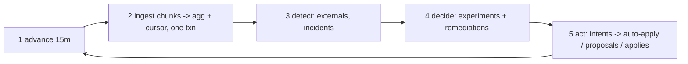

# Controller design

Based on observations in `docs/analysis_step5.md`, `docs/analysis_step6.md` and the contract in `docs/SIMULATOR.md`. Approved base decisions: one process + one 15-min tick loop (A), SQLite WAL (B), intent-log crash safety (C), incremental ingestion (D).

## Words used in this doc (plain Hinglish)

| Word | Matlab |
|---|---|
| **tick** | Ek chakkar of the loop — hum sim ko 15 minute aage badhate hain, phir naya data padhte hain aur faisle lete hain. |
| **cohort** | Logo ka group jo features se banta hai (jaise "60+ umar, Tamil"). Config mein cohort ko alag allocation de sakte hain. |
| **variant / arm** | Ek option jo hum try kar rahe hain (jaise voice V2). Experiment ke har group ko "arm" kehte hain. |
| **champion / challenger** | Champion = abhi ka best option jo zyada traffic leta hai. Challenger = naya option jisko thoda traffic dekar test karte hain. |
| **baseline** | "Normal kya hai" ka number, history se nikala hua. Isi se compare karke pata chalta hai kuch badla ya nahi. |
| **guardrail** | Doosra KPI jo girna nahi chahiye jab hum primary KPI sudhaar rahe hain (jaise engagement badhao par pickup 2pp se zyada mat girao). |
| **decay** | Jeeta hua variant time ke saath kaam karna band kar de — uska asar ghis jaye. |
| **idempotent** | Ek hi kaam do baar karne se doosri baar kuch nahi bigadta. Jaise same proposal_id dobara bhejna → sim 409 deta hai, duplicate nahi banta. |
| **intent log** | "Main ye bhejne wala hoon" ki entry jo bhejne se PEHLE database mein likhte hain. Crash ho jaye toh restart pe pata hota hai kya bheja tha ya bhejne wale the. |
| **reconcile** | Restart ke baad apne DB ko sim ke sach se milana — GET /approvals aur config/history se poochkar. |
| **slice** | Data ka ek tukda jise alag se monitor karte hain (jaise "sirf caller_id D2 ka pickup"). |
| **z-score** | Kitne "surprise" ka number — observed rate baseline se kitna door hai, noise ke hisaab se. |z|≥3 matlab bahut unlikely ki ye noise hai. |
| **TV distance (max_shift)** | Allocation kitni badli uska naap (0 = same, 1 = poori ulti). Auto-apply mein policy isko limit karti hai. |
| **TTL / apply window** | Proposal kitni der zinda rehta hai (TTL); approve hone ke baad kitni der mein apply karna zaroori hai (apply window). |
| **dry run** | Change lagane se pehle purane data pe "agar ye lagaya hota toh kya hota" ka hisaab. |

## 1. Module layout (small on purpose)

```
controller/
  __main__.py    entrypoint: parse SIM_URL, open store, run loop
  api.py         HTTP client (httpx): typed calls, retries/backoff, error mapping
  store.py       SQLite (WAL): schema, migrations, transaction helpers
  ingest.py      fetch new chunks -> parse -> update aggregates + cursor (one txn)
  policy.py      runtime policy from GET /workflows: routes, limits, timing windows
  detect.py      baselines + rolling detectors + external-change watch
  experiments.py experiment lifecycle: design, min-n, winner test, decay watch
  govern.py      proposals/auto-apply: build, intent log, send, poll, apply, reconcile
run.sh           creates venv if needed, installs, exec python -m controller <SIM_URL>
```

Call graph: `__main__` → loop calls `ingest` → `detect` → `experiments` → `govern`, each using `store` + `api` + `policy`. No module imports `sim`, reads `runs/` or scenario files. All state keyed by `workflow_id` (shard-ready).

Production path (written here as required): same design, SQLite → **Postgres** (same SQL, WAL→MVCC), one process per shard of workflows behind a work-queue; ingestion becomes a consumer on the event stream.

## 2. SQLite tables

| Table | Columns (key ones) | Purpose | Written by |
|---|---|---|---|
| `meta` | key, value | event cursor (`last_chunk`, `last_event_id`), schema version | ingest |
| `workflows` | wid PK, policy_json, fetched_at | runtime policy cache (refreshed each day + on 4xx surprises) | policy |
| `config_versions` | (wid, version) PK, actor, changed_dims, ts, config_json | every version we've seen (`config_changed` + `/config/history`) | ingest, govern |
| `campaigns` | campaign_id PK, wid, created_ts, leads, config_version_at_creation | mid-flight rules need per-campaign version | ingest |
| `leads` | lead_id PK, wid, person_id, campaign_id, lang, city_tier, age_band, value_band, done | feature joins; `affected_leads` counts | ingest |
| `agg_calls` | (wid, hour_ts, config_version, cohort_id, welcome, voice, caller_id, prompt) PK, dials, connected, engaged, halluc, adher_lo, adher_sum | **the one shared cohort object (C2)**: detection, experiments and proposals all read this | ingest |
| `baselines` | (wid, metric, slice, hour) PK, rate, n, sd | hour-matched history baselines | detect |
| `experiments` | exp_id PK, wid, dimension, cohort, arms_json, start_version, status, started_ts, decided_ts, winner, notes | experiment lifecycle (C6/C7) | experiments |
| `intents` | proposal_id PK, wid, kind(approval/auto/apply), base_version, payload_json, status(pending_send/sent/acked/failed), created_ts | crash safety: written BEFORE any send | govern |
| `proposals` | proposal_id PK, approval_id, wid, status, base_version, expires_at, apply_by, reasons, decided_ts | mirror of the sim's approval lifecycle + our `stale` | govern |
| `incidents` | id PK, wid, slice, metric, onset_ts, detected_ts, action_proposal_id, resolved_ts | incident audit (C5/C8) | detect, govern |
| `audit` | id PK, ts, wid, kind, ref_id, details_json | the queryable "why did X change" store (C12) | all |

`proposal_id` is **deterministic**: `sha256(wid | base_version | canonical_json(diff) | intent-kind)[:32]`. A crash between "intent written" and "send" can only re-send the same id → sim answers `409 duplicate_proposal_id` → we mark it `sent` and move on. No double-apply.

## 3. The tick loop, and restart at each step



0. **Startup / restart (reconcile)** — read cursor from `meta`; `GET /sim/state` (if `finished`, exit 0). For every intent not `acked`: `GET /approvals?workflow_id=` and `/config/history` to learn what actually happened (sent-but-crashed → found there; never-sent → re-send same deterministic id). Refresh policies.
1. **Advance** — `POST /sim/advance {minutes:15}`. Crash after advance, before ingest: fine — chunks are immutable and listed by `GET /events/chunks?after=cursor`; nothing is lost. (We advance first, read later: events are pulled by chunk list, not only from the advance response.)
2. **Ingest** — fetch chunks after cursor; for each event update `leads` / `campaigns` / `agg_calls` / `config_versions`; ignore `event_id ≤ last_event_id` (idempotent); write aggregates **and** new cursor in ONE transaction. Crash mid-txn → rollback → the whole chunk is re-read next start; re-processing is safe because the cursor only moves with the data.
3. **Detect** — run rules of §6 over `agg_calls` + `baselines`; new `config_changed` with foreign actor triggers §7. Pure reads + `incidents`/`audit` writes; crash here loses nothing (recomputed next tick).
4. **Decide** — experiments engine (§Experiments) proposes starts/promotions/rollbacks; remediation for incidents. Decisions are written as intents (status `pending_send`) in the same txn as their audit row.
5. **Act** — for each pending intent: send (auto-apply PUT, POST /approvals, or POST apply for approved ones), then mark `sent`/`acked` with the response. Poll pending approvals; apply approved ones inside their `apply_window`. Crash anywhere: step 0 reconciles by proposal_id.

## 4. Proposal state machine

```
                       +-> rejected (terminal; if reason transient e.g. judgement-call -> may re-propose once with better evidence)
pending ---------------+-> approved --+-> applied (terminal)
   |                                  +-> lapsed  (missed apply_window; terminal; re-propose)
   +-> expired (TTL hit; terminal; re-time next send)
   
any non-terminal --(config version changed under it)--> stale (our local state; withdraw mentally, re-propose on fresh base_version)
```

Transitions we drive: create (`POST /approvals`), apply (`POST .../apply`). Transitions the world drives: approved/rejected (approver, seen via `approval_decided` event or polling), expired (TTL), lapsed (apply too late → 410), stale (409 `stale_base_version` on apply, or a `config_changed` for the same wid with a newer version while we wait). `stale` is OUR state, the sim doesn't have it — we mark it locally so we never apply a config computed against an old world.

## 5. Policy at runtime (nothing hardcoded)

Read per workflow from `GET /workflows/{wid}` every run-day and cache in `workflows`:

- **Route per change**: compute changed dims; if `auto_apply.enabled` AND all dims ⊆ `allowed_dims` AND TV-shift per cohort-dim ≤ `max_shift` → PUT (free, instant). Else → approval path. `prompt_version` is **never** auto-applied by us even if a policy listed it: constraint §5.4 + validation evidence is only checkable by an approver; we treat prompt changes as approval-only with `evidence.validation_run_id` attached (pass_rate ≥ `min_validation_pass_rate`, n sized per step-5 noise finding, ≥200).
- **Mid-flight**: if `mid_flight: next_campaign_only`, cohort/allocation changes only affect campaigns created after apply — our experiment clocks start at the **next campaign**, not at apply time; `prompt_version`/`schedule` still act immediately. (nw_kyc-style.)
- **When to send** (generic timing rule): send a proposal at the start of an `approver_hours` window such that `created_at + max(approver_latency)` still lands inside approver hours and before `expires_at`; set `expires_in_hours = min(policy TTL, hours until approver window closes + buffer)`. Never submit into a closed approver window whose TTL dies before it reopens (the ks_cancel naive bug). Respect `max_requests_per_24h` by batching several dims into one proposal when they're ready together.
- **Apply fast**: poll approvals every tick; apply inside `apply_window_hours` immediately on approval.

## 6. Detection (generic rules from analysis_step6)

1. **External-change watch**: `config_changed` with actor ≠ ours → §7.
2. **Sliced detectors**: rolling ~4h window per workflow aggregate AND per slice. Slice list is **limited and fixed by structure, not fished from data**: each `caller_id` option, each configured cohort, each dimension-option currently carrying ≥20% traffic — order tens of slices per workflow, not thousands. Alarm only if ALL hold: |z| ≥ 3 vs **hour-matched** baseline; |effect| ≥ max(3pp, 3× daily sd); window n ≥ 300; rare metrics (halluc) additionally ≥5 positives.
3. **Multiple-comparisons correction**: with S slices × M metrics tested each tick, a fixed z=3 still fires on noise over a long run. We control this by (a) the limited slice list, (b) requiring the alarm to persist for 2 consecutive evaluations before acting, and (c) per-(workflow,slice,metric) 24h alarm cooldown. (Bonferroni across S×M would be the formal alternative; persistence+cooldown is simpler and was enough on public_02.)
4. **Slow-drift backstop**: 24h window, same effect-size floor (catches decay-type fades the 4h window misses).
5. **Remediation**: prefer the most specific firing slice; standard response = shift allocation away from the degraded option (often auto-apply-able), or the §C8 prompt pipeline for hallucination spikes: detect → `POST /llm/suggest-fixes` → `POST /validation/runs` (n≥200) on candidates → propose with `evidence` → after apply, verify halluc rate returns toward baseline; if not, next candidate.
6. **TODO (re-measure)**: the step-6 lag numbers (41 min / 2 h) were measured with a looser rule (no n≥300, no persistence). Re-measure detection lag on public_02 with the FINAL rule before freezing thresholds.
7. **Baselines**: hour-matched from history chunks; levels recalibrated on live non-alarm data (history level can be ~2pp off).

## 7. Supervisor edits (never fight the human)

On `config_changed` with `actor:"supervisor"`:
1. Insert the new version into `config_versions`; **all aggregates are already segmented by `config_version`**, so stats "reset" naturally at the boundary — we simply never mix versions in a comparison.
2. Mark running experiment arms on that workflow `invalid` (their traffic split just changed under them); restart them on the new base if still relevant.
3. Mark our pending proposals for that workflow `stale`; rebuild on the new `base_version` with fresh data if still justified (`409 stale_base_version` would catch us anyway — we act before the error, not after).
4. **Never propose a change whose effect is just "undo the supervisor's edit"** — unless detection independently shows the new config degrades a KPI (then it goes through governance like any change, with the evidence attached, and the audit row says so).
5. Run the §6 before/after comparison on all four metrics for the hours after the edit (a bad supervisor prompt looks exactly like our public_02 incident).

## Experiments and winners (C6/C7, simple words)

- **Which dimension first**: per workflow, at most ONE live experiment, on ONE dimension at a time. Default order: `voice` or `welcome_message` at **workflow level** for engagement-primary workflows (step-5: engagement tests only have power at workflow level); `schedule`/`caller_id` and coarse single-feature cohorts for pickup-primary workflows (pickup has 4× the denominator, can go finer). Which of voice/welcome goes first: the one with more untested options and any prior signal (history gives none on variants — it ran one variant — so day-1 priors come from nothing; we start with the cheapest-to-test dimension, usually the one auto-apply allows, because it needs no approver).
- **Traffic split (risk small)**: champion keeps most traffic; each challenger gets a small share — **20–30% total to challengers**, never a 100% flip (naive's harmful change). Where auto-apply is allowed, the split must also fit `max_shift` TV distance, which usually caps challenger share at `max_shift` itself — then we either stage two shifts or route through approval.
- **Minimum samples per arm, before judging** (step-5 numbers, engagement near 0.5): ≈**380/arm for a 10pp** lift, ≈**1550/arm for 5pp**; pickup near 0.25: ≈330 (10pp) / ≈1250 (5pp). With a 25% challenger share on ~1000 connected/day, a 5pp engagement test needs ~6 days — so in short scenarios we hunt 10pp effects first and only continue to 5pp when the scenario is long enough. No judgement before min-n, whatever the interim numbers look like.
- **Winner test (deterministic, no LLM)**: two-proportion z-test challenger vs champion on the primary KPI, α=0.05 two-sided, **Bonferroni-corrected** for k challengers (α/k). An LLM may suggest *what* to try (prompts); it never decides *what won* (README §5.4).
- **Expected false-winner rate and its cost**: with the correction, the family-wise false-winner rate stays ≤5% per experiment. The price is speed: α/2 instead of α needs ~15–20% more samples per arm (roughly +1 day on a 5pp engagement test). We pay it — a false winner becomes a "harmful change applied", which the grader (and reality) punishes more than a day of waiting.
- **Guardrail before promotion**: promote only if the guardrail KPI's point estimate hasn't dropped more than the policy's limit (e.g. `pickup_rate_max_drop: 0.02`) AND the drop isn't statistically significant. A win on the primary that buys a guardrail breach is not a win.
- **After promotion — decay watch and rollback**: the promoted variant is monitored by the §6 24h slow-drift detector against its own post-promotion level. If the win fades (significant sustained fall with the effect-size floor), we **roll back through governance** (propose/auto-apply the previous champion), citing the decay evidence. Winners are never "set and forget" (the grader's decay table exists for a reason).
- **welcome × voice interaction**: we test one dimension at a time, holding the other at its current champion. Why: a full 2-dimension grid needs roughly 4× the samples (step-5 shows even 1-D tests are tight), and sequential 1-D search still finds a good cell when effects are mostly additive. Cost: if a strong *interaction* exists (a combo is great while both parts look mediocre alone), we can miss it — accepted and written down.

## C10 — honest impact numbers (minimal but real)

- **`affected_leads`**: count from our `leads` table of not-done leads in the affected cohorts of active campaigns (plus, for `next_campaign_only` workflows, the mean campaign size of this workflow as the next-campaign estimate). An integer from real rows, not a guess.
- **`impact_score`**: expected extra primary-KPI events per day ÷ the workflow's current daily primary-KPI events, clamped to [0,1]. The expected-gain term = (measured challenger rate − champion rate) × the daily volume the change would move. All three factors come out of `agg_calls`. Example wording the approver sees: "moves 25% of voice traffic to V2; measured +6.8pp engagement over 412 calls → ≈ +18 engaged calls/day (score 0.17)".
- **`dry_run`**: counterfactual replay against the last 7 days of `agg_calls`: apply the proposed allocation weights to each cohort's observed per-option rates, report "KPI would have been X instead of Y (Δ)" plus the sample sizes. For prompt proposals, the dry run also carries the validation `pass_rate` and n.
- **What the approver sees**: `change_summary` (one plain line), the diff, these three honest numbers, and `rationale` citing the experiment/incident id from `audit` — the same ids we'd defend in the review.

## Scope (C-list)

**Build:** C1 (idempotent cursor ingestion, load-tested), C2 (`agg_calls` + `leads` as the one shared cohort object), C5 (caller-ID health via sliced detector + rotation through allocation shift), C6/C7 (experiments, winners, decay rollback — above), C8 (hallucination pipeline — §6.5), C9 (full governance client — §4/§5), C10 minimal-honest (above), C12 (`audit` + `incidents`, queryable by SQL with documented queries), C13 (intent log + reconcile, demonstrated with a kill/restart script), C14 minimal (per-tick counters: ingest lag events/s, decisions made, credits left, pending approvals — logged + one `status` audit row per day).

**Cut, with reasons:**
- **C3 partial**: we DO use history for baselines and cohort priors (free, already built in steps 5–6), but no full "pre-D0 bootstrap" of experiments/allocations — history has no variant diversity to learn variants from (verified in step 5), so deeper bootstrap buys nothing.
- **C4**: call-time optimisation (per-person preferred hours, per-cohort hour weights) — real headroom exists (step-5 hour effects), but it's a separate optimisation loop competing for the same test budget; cutting it keeps the experiment engine honest. The schedule dim stays available for incident remediation.
- **C11 minimal**: no UI. The "supervisor view" is a handful of documented SQL queries over `audit`/`incidents`/`proposals`. A UI is pure surface area in a 12–16h budget.
- **C15**: fair cross-tenant credit/attention allocation — with a per-workflow `max_requests_per_24h` already policed by the sim and only ~3–12 workflows in scenarios, a fairness scheduler is speculative; we keep a global credit reserve (open question 4) instead.

## Open questions (max 5)

1. **Challenger traffic share** — (a) conservative 20% (slower, safer) vs (b) 30% (faster, a bad challenger hurts ~1.5× more). **Recommendation: (b) 30%**, capped by `max_shift` when auto-applying; scenarios are short, speed of learning dominates, and min-n rules bound the damage window.
2. **Reject ("judgement call") retry** — (a) re-propose once next approver window with improved evidence vs (b) drop the idea. **Recommendation: (a)** — base_reject_rate is 5–15% random; one retry recovers real wins cheaply, a single retry cap avoids approver fatigue.
3. **Schedule dimension** — (a) leave schedule completely untouched vs (b) allow it ONLY as incident remediation (shift hours away from a degraded window). **Recommendation: (b)**; it's auto-apply-allowed in some policies and costs no test budget, but we don't optimise it proactively (that's cut C4).
4. **Credit reserve** — (a) hard reserve 40 credits for incidents (validation+suggest cycles ≈ 3+2×2 = 7+ per incident) vs (b) spend freely on proactive validation. **Recommendation: (a)** — running out mid-incident is a named failure mode (README §5.7).
5. **Language/runtime** — (a) Python (fastest to build, httpx+sqlite3 stdlib, risk: ingest throughput at 850k events/day) vs (b) Go (fast, but slower to write and defend). **Recommendation: (a) Python**, with the load scenario as the gate; ~10 events/ms parsing is enough and aggregates keep memory flat. If it fails the load test, the ingest hot path gets optimised, not rewritten.
