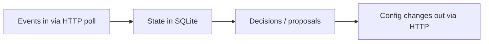

# Flow map

Living map of the controller system. Everything below is **planned** — no controller code exists yet. Update this file in the same commit as every change.

## (a) Event flow diagram — planned

## (b) Modules — planned

| Module/File | What it does | Imports / called by |
|---|---|---|
| _(planned)_ | | |

## (c) Simulator endpoints we call — planned

| Endpoint | Called by | When | With what | Failure handling |
|---|---|---|---|---|
| _(planned)_ | | | | |

## (d) Proposal state machine — planned

_(planned)_

## (e) Storage & restart — planned

What is stored where in SQLite and what happens on restart: _(planned)_
