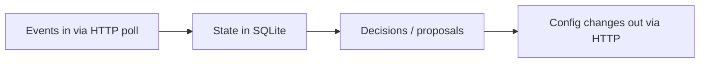

# Flow map

Living map of the controller system. Everything below is **planned** — no controller code exists yet. Update this file in the same commit as every change.

## (a) Event flow diagram — planned

## (b) Modules — planned

| Module/File | What it does | Imports / called by |
|---|---|---|
| _(planned)_ | | |

## (c) Simulator endpoints — observed via HTTP (step 3, public_01_dev)

Controller modules not built yet, so "Called by" is planned. Observed behaviour from live server + naive example run:

| Endpoint | Observed behaviour | Called by (planned) | Failure handling (planned) |
|---|---|---|---|
| `GET /health` | liveness check | startup wait loop | retry until up |
| `GET /sim/state` | `{scenario, sim_minute, ts, end_minute, finished, tick_minutes, credits_remaining, chunks, last_event_id}`. public_01_dev: tick=15min, end=11520min (8 sim days), 200 credits | main loop (stop when `finished`) | retry with backoff |
| `POST /sim/advance` `{minutes}` | advances sim time, returns state + `new_chunks` list; this is how time moves — sim is turn-based, not realtime | main loop | retry; advance is the clock, must not skip |
| `GET /events/chunks?kind=history` | pre-start history chunks (chunk 0 = events from 2026-12-21, before sim start 2027-01-04). Plain `GET /events/chunks` returned `[]` before advancing | startup (warm stats) | retry |
| `GET /events/chunks/{n}` | NDJSON, one event per line. Seen types: `campaign_created`, `lead` (features: lang, city_tier, age_band, value_band), `call` (has `connected`, `engaged`, `variant{voice,...}`) | event ingester | re-fetch chunk; chunks are immutable |
| `GET /workflows` | full policy per workflow: options per dim (welcome_message, voice, caller_id, prompt_version), objective + guardrail, governance (auto_apply dims/max_shift, approver_hours, proposal_ttl, apply_window, max_requests_per_24h, min_validation_pass_rate), mid_flight rule. 3 workflows in public_01_dev: nw_renewal, nw_kyc, ks_cancel | startup + periodic refresh (policy read at runtime, never hardcoded) | retry |
| `GET /workflows/{wid}/config` | `{workflow_id, version, actor, applied_at, config{cohorts, allocations{cohort→dim→{option: weight}}, prompt_version, schedule}}` | before proposing | retry |
| `PUT /workflows/{wid}/config` | auto-apply path (only governance-allowed dims, max_shift limit) | decision engine | handle 4xx = policy violation, don't retry blindly |
| `GET /workflows/{wid}/config/history` | past versions | not decided yet | — |
| `POST /approvals` | request human approval; 200 → `approval_id`; 422 `no_change` if proposed == current | decision engine | treat 422 as our bug |
| `GET /approvals` / `GET /approvals/{aid}` | status: pending → approved/rejected/expired/lapsed, with `reasons`. Observed: rejections ("approver declined (judgement call)") and expiries (ks_cancel approver window closed before TTL) | approval poller | retry |
| `POST /workflows/{wid}/apply` `{approval_id}` | applies an approved proposal → new version + `changed_dims`. Must happen within `apply_window_hours` | approval poller | handle lapsed window |
| `POST /llm/suggest-fixes` | not yet observed (likely costs credits — `credits_remaining: 200`) | TBD | — |
| `POST /validation/runs` | not yet observed; governance has `min_validation_pass_rate: 0.97`, so likely required before prompt changes | TBD | — |

## (d) Proposal state machine — planned

_(planned)_

## (e) Storage & restart — planned

What is stored where in SQLite and what happens on restart: _(planned)_
