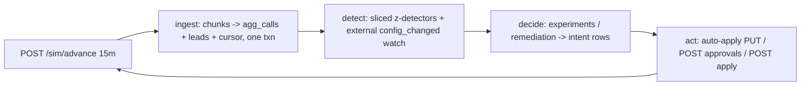

# Flow map

Living map of the controller system. Design is frozen in `docs/design.md` (step 8). **Phase A+B built**: loop, api, store (state.db + calls.db), ingest (15.1k events/s, ~640 MB peak), policy (runtime routes + preferences), govern (intents/reconcile, round-trip verified), detect (external-watch; z-detectors in Phase C), experiments (one-dim champion/challenger 70/30, Bonferroni winner test — A/A false-winner rate 2.1–3.0%, promotion 80/20, decay watch, supervisor-edit invalidation, next_campaign_only handled by config_version filtering), why CLI, run.sh. Update this file in the same commit as every change.

## (a) Event flow diagram — built (Phase A)

## (b) Modules — designed (design.md §1), not yet built

| Module/File | What it does | Imports / called by |
|---|---|---|
| `controller/__main__.py` | entrypoint, main loop | calls ingest, detect, experiments, govern |
| `controller/api.py` | httpx client, retries, error mapping | used by all; imports nothing of ours but store-less |
| `controller/store.py` | SQLite WAL schema + txn helpers | used by all |
| `controller/policy.py` | runtime policy from GET /workflows | used by detect, experiments, govern |
| `controller/ingest.py` | chunks → aggregates + cursor (one txn) | called by main |
| `controller/detect.py` | baselines, rolling detectors, external watch | called by main |
| `controller/experiments.py` | experiment lifecycle + winner test + decay watch | called by main |
| `controller/govern.py` | intents, proposals, auto-apply, apply, reconcile | called by main |
| `controller/why.py` | CLI: audit queries + per-call `heard` lookup | manual use |
| `run.sh` | venv + `python -m controller <SIM_URL>` | entry |

Routing rule (D009): welcome_message/voice/prompt_version → ALWAYS approval path; auto-apply only caller_id/schedule where policy allows. Storage: state DB + separate insert-only `calls.db` (per-call variant/cohort/config_version for compliance lookups).

## (c) Simulator endpoints — observed via HTTP (step 3, public_01_dev)

Controller modules not built yet, so "Called by" is planned. Observed behaviour from live server + naive example run:

| Endpoint | Observed behaviour | Called by (planned) | Failure handling (planned) |
|---|---|---|---|
| `GET /health` | liveness check | startup wait loop | retry until up |
| `GET /sim/state` | `{scenario, sim_minute, ts, end_minute, finished, tick_minutes, credits_remaining, chunks, last_event_id}`. public_01_dev: tick=15min, end=11520min (8 sim days), 200 credits | main loop (stop when `finished`) | retry with backoff |
| `POST /sim/advance` `{minutes}` | advances sim time, returns state + `new_chunks` list; this is how time moves — sim is turn-based, not realtime | main loop | retry; advance is the clock, must not skip |
| `GET /events/chunks?kind=history` | pre-start history chunks (chunk 0 = events from 2026-12-21, before sim start 2027-01-04). Plain `GET /events/chunks` returned `[]` before advancing | startup (warm stats) | retry |
| `GET /events/chunks/{n}` | NDJSON, one event per line. Seen types: `campaign_created`, `lead` (features: lang, city_tier, age_band, value_band), `call` (has `connected`, `engaged`, `variant{voice,...}`) | event ingester | re-fetch chunk; chunks are immutable |
| `GET /workflows` | full policy per workflow: options per dim (welcome_message, voice, caller_id, prompt_version), objective + guardrail, governance (auto_apply dims/max_shift, approver_hours, proposal_ttl, apply_window, max_requests_per_24h, min_validation_pass_rate), mid_flight rule. 3 workflows in public_01_dev: nw_renewal, nw_kyc, ks_cancel | startup + periodic refresh (policy read at runtime, never hardcoded) | retry |
| `GET /workflows/{wid}/config` | `{workflow_id, version, actor, applied_at, config{cohorts, allocations{cohort→dim→{option: weight}}, prompt_version, schedule}}` | before proposing | retry |
| `PUT /workflows/{wid}/config` | auto-apply path (only governance-allowed dims, max_shift limit) | decision engine | handle 4xx = policy violation, don't retry blindly |
| `GET /workflows/{wid}/config/history` | past versions | not decided yet | — |
| `POST /approvals` | request human approval; 200 → `approval_id`; 422 `no_change` if proposed == current | decision engine | treat 422 as our bug |
| `GET /approvals` / `GET /approvals/{aid}` | status: pending → approved/rejected/expired/lapsed, with `reasons`. Observed: rejections ("approver declined (judgement call)") and expiries (ks_cancel approver window closed before TTL) | approval poller | retry |
| `POST /workflows/{wid}/apply` `{approval_id}` | applies an approved proposal → new version + `changed_dims`. Must happen within `apply_window_hours` | approval poller | handle lapsed window |
| `POST /llm/suggest-fixes` | observed: body `{workflow_id, problem}` (missing `problem` → `{"error":"missing_fields","detail":["problem"]}`). Returns `suggestions: [{prompt_version, summary}]` — just the prompt catalog reordered, no quality info. **Costs 3 credits** per call. Unknown workflow → `{"error":"unknown_workflow"}` | TBD | validate inputs before calling (credits are spent even if output is useless) |
| `POST /validation/runs` | observed: body `{workflow_id, prompt_version, n}` (bad prompt → `{"error":"bad_prompt_version"}`). Returns `{validation_run_id, failures, pass_rate, ts, credits_remaining}`. **Cost: 1 credit per 100 samples rounded up** (n=50→1, n=200→2). pass_rate is noisy: same prompt n=50 gave 0.98 then 1.00 — n=50 is too small to certify `min_validation_pass_rate: 0.97` | prompt-change gate | re-run / increase n before trusting a pass |

### Observed event types (beyond lead/call/campaign_created)

- `approval_decided` — `{approval_id, workflow_id, status: approved|rejected, reasons, ts}`; verified for BOTH approved and rejected cases (step 5); decision also visible by polling `GET /approvals/{aid}`.
- `config_changed` — `{workflow_id, version, actor, changed_dims, proposal_id, approval_id, ts}` emitted on apply. Also fires for EXTERNAL changes: `actor:"supervisor"` with null proposal/approval ids (step 6) — the controller's only reliable signal for supervisor edits.
- `call.qa` — `{hallucination_flag, flow_adherence}` on connected calls; baseline halluc rate ~1.3–1.7% (imperfect detector), flow_adherence mean ~0.93 (step 6).

### Error shapes observed

- 404 `{"error":"unknown_workflow","detail":"<wid>"}` (suggest-fixes, validation, approvals)
- 422 `{"error":"no_change"}` (proposal equal to current config)
- 422 `{"error":"missing_fields","detail":[...]}`, `{"error":"bad_prompt_version"}`
- 409 `{"error":"not_approved","detail":{"status":"applied"}}` (re-applying a used approval)

### Verified: why ks_cancel approvals always expired in the naive run

ks_cancel governance (from API): `proposal_ttl_hours: 12`, `approver_hours: [10,19]`. Naive submitted daily at 20:00 → proposal expires 08:00 next morning, but the approver only starts at 10:00. The approver never saw a single proposal. Fix is trivial: submit during (or shortly before) approver hours. Also: ks_cancel allows **auto-apply on voice/welcome_message/schedule/caller_id with max_shift 0.2** — most changes there don't need approval at all.

## (d) Proposal state machine — designed (design.md §4)

`pending → approved | rejected | expired`; `approved → applied | lapsed`; any non-terminal → `stale` (our local state when the base config version changes under the proposal — rebuild on the new base). We drive create and apply; the world drives approve/reject (approval_decided event), expire (TTL) and lapse (apply_window missed, HTTP 410). Stale is detected proactively from `config_changed` events, or reactively via 409 `stale_base_version`.

## (e) Storage & restart — designed (design.md §2–3)

SQLite (WAL), one file. Tables: `meta` (event cursor), `workflows` (policy cache), `config_versions`, `campaigns`, `leads`, `agg_calls` (the shared cohort/aggregate object; keyed by wid, hour, config_version, cohort, variant dims), `baselines`, `experiments`, `intents` (written before every outbound mutation; deterministic proposal_id), `proposals`, `incidents`, `audit`.

Restart: read cursor → reconcile un-acked intents against `GET /approvals` + `/config/history` (resend-safe: same deterministic id → 409 duplicate) → resume loop. Cursor and aggregates commit in one transaction, so a crash can only re-read a whole chunk, never lose or double-count one.
